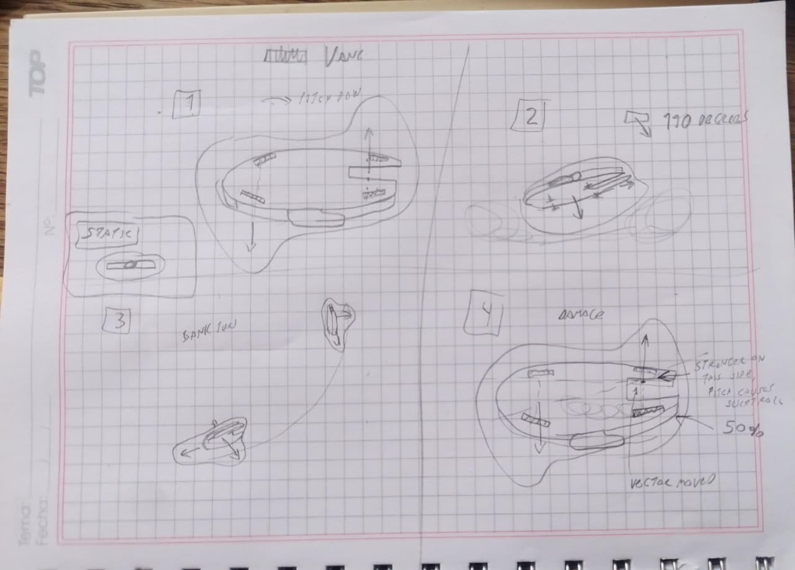

# SPACE TRUCKER — GAME DESIGN DOCUMENT

**Working title:** Not chosen  
**Document version:** 0.1 — Concept baseline and first-prototype plan  
**Date:** 9 November 2026  
**Project status:** Pre-production / design definition  
**Engine target:** Godot 4.x  
**Initial platform:** Windows PC  
**Primary input:** Keyboard and mouse; controller support is also planned  
**Player model:** Single-player, one actively operated ship at a time

> **Purpose of this document**  
> This is the project's portable source of truth for the concept and the decisions made so far. It is intended to be useful both to the developer and as context in future design or programming conversations. It records the intended experience, the fictional rules, the proposed technical architecture, the first prototype and the questions that remain open. It is not a claim that every proposed feature has already been implemented or fully specified.

## Contents

1. Executive summary  
2. Design pillars  
3. Inspirations and what to learn from them  
4. Player role, gameplay loop and progression  
5. The universe and environmental structure  
6. Hyperspace and long-distance travel  
7. The player, ship interior and walkaround experience  
8. Ship systems and startup procedure  
9. Repulsorlift technology and field model  
10. Flight model and flight-control computer  
11. Atmospheric protection and lifting-body field  
12. Cargo, mass and center of mass  
13. Vane temperature, degradation and damage  
14. Ship care, personality and the “ship likes you” idea  
15. Economy, contracts, side jobs and hazards  
16. Emergency systems  
17. Visual, audio and interaction direction  
18. Godot technical direction  
19. First prototype: flight and force-model validation  
20. Development roadmap and scope discipline  
21. Open questions and intentionally unresolved decisions  
22. Project terminology  
23. Handoff brief for future development conversations  
Appendix A. Repulsorlift vane concept sketch  
Appendix B. Technical references

\newpage

## How to read this document

Decisions are tagged by status:

- **CONFIRMED** — Explicitly chosen by the project owner.
- **DESIGN DIRECTION** — A clear intention or target, but details may still change.
- **PROPOSED** — A technical or design recommendation to test. Do not treat it as immutable canon.
- **TBD** — Deliberately unresolved. Decide when the relevant prototype or design work makes the answer concrete.
- **PLACEHOLDER** — A provisional number or example used for discussion, not a balancing commitment.

When updating this document, preserve the distinction. A suggestion does not become confirmed merely because it appears here.


# 1. Executive summary

## 1.1 High concept

**CONFIRMED —** A single-player, 3D space-trucking and spaceship-operations game with a walkable on-foot mode; the exact camera perspective is still to be decided. The player is an independent owner-operator who works with a contractor, accepts transport contracts and eventually takes side jobs. The player owns and operates a ship, flies it, maintains it, upgrades it, and gradually builds a livelihood in a lived-in science-fiction universe.

The central fantasy is not simply controlling a spacecraft. It is **owning, operating and living aboard a working spaceship**: preparing it for departure, bringing systems online, managing a fictional but consistent propulsion technology, carrying cargo, navigating to ports, inspecting damaged equipment, making repairs, earning money, and returning to a place that feels like home. A quiet moment at a spaceport—sleeping aboard while rain taps against the canopy—is as much part of the intended emotional identity as a difficult landing.

The universe should feel Star Wars-like in its variety and lived-in quality, but the technology and operations should be explained as consistently and plausibly as the fiction permits. *Firefly* is another major tonal reference: a working vessel with character, imperfections and a relationship with its owner.

## 1.2 Core promise

The player should feel that:

1. The ship is a machine with systems that must be operated, not a menu icon that transports cargo.
2. Flying has weight, inertia and consequences, while the flight computer keeps the craft enjoyable rather than making it an uncontrolled physics sandbox.
3. The ship's components matter. Their location, condition, temperature and available power affect the craft's actual behavior.
4. Cargo, maintenance and operational decisions change how the ship flies and how much risk the player can accept.
5. Space is a place with routes, stations, contractors, landing sites and people—not just a sequence of mission menus.
6. The ship is also the player's workplace and, over time, their home.

## 1.3 Current scope boundaries

**CONFIRMED / DESIGN DIRECTION**

- Godot 4.x, 3D, single-player, Windows PC initially.
- Keyboard and mouse are the primary controls; controller support is also planned.
- Several ships may be acquired and upgraded, but the player directly operates one ship at a time.
- The initial playable prototype uses a cube for the ship, a ground plane and a landing pad. No finished ship model is required to validate flight.
- Environmental scale is hybrid: a simplified system-level representation, local orbital spaces and small detailed planetary landing areas.
- Long-distance travel uses hyperspace transitions, both within a star system and between systems.
- The first major technical risk to solve is the flight model and its feel—not procedural planets, interiors, trading or a large universe.


# 2. Design pillars

## Pillar 1 — The ship is a home as well as a vehicle

**CONFIRMED —** The game should capture the personal attachment that can develop between an owner and a ship. The ship is somewhere the player returns to, sleeps in, maintains and gradually learns to understand.

Long-term examples include:

- Sleeping aboard while weather passes over a landed ship.
- Hearing rain against the canopy, machinery ticking as it cools, fans, pumps and other quiet ship ambience.
- Performing walkarounds and noticing wear, dirt, misalignment or damage.
- Recognizing a particular ship's quirks and preferences.
- Having a ship feel dependable because it has been treated well, rather than because a numerical upgrade was purchased.

This is not intended to become a survival game with mandatory hunger or thirst meters. The emphasis is atmosphere, routine, familiarity and attachment.

## Pillar 2 — Operating a machine, not pressing a travel button

The ship has a startup sequence, power generation, a repulsorlift generator, control vanes, thermal limits, cooling and damage. These systems should have understandable causal relationships. The player should be able to make an informed decision to push the ship beyond its comfortable operating range and accept the consequences.

## Pillar 3 — Assisted, weighty flight

The ship follows simplified Newtonian motion. It has mass, inertia, angular velocity, drag in atmosphere, lift from a fictional shield system and forces generated by the repulsorlift field. An onboard flight-control computer (FCC) provides assistance, producing a responsive, aircraft-like control feel when the ship is inside its operating envelope.

The control feel should take cues from *Tiny Combat Arena*, not from a realistic spacecraft simulator with deliberately hostile controls. The ship should still feel like a capable but heavy, working Millennium Falcon-style freighter: reasonably manageable when light, increasingly sluggish and demanding under load, and never a nimble fighter.

## Pillar 4 — Components have physical consequences

Vane location and condition should change the resulting forces and torques. A damaged vane should not merely subtract a generic percentage from a pitch or roll stat. Damage should create a measurable, understandable change in behavior, such as a small unwanted roll during a pitch maneuver.

## Pillar 5 — A lived-in space-opera world

The universe draws strongly from Star Wars roleplaying games (West End Games and Fantasy Flight Games), *Firefly* and classic space-trading games. The world should support contractors, side jobs, ports, rumors, illicit work, upgrades and discoveries. Its technology can be fictional, but its rules should remain consistent enough for players to reason about them.

## Pillar 6 — Low-fi art, high polish

**CONFIRMED —** Optimization, readability and polish matter more than visual fidelity. The intended look combines 1990s 3D and PS1-era visual character, especially in the cockpit, with selective modern rendering techniques where they improve lighting, readability or atmosphere. Low fidelity must not mean sloppy interaction, poor feedback or unstable systems.


# 3. Inspirations and what to learn from them

These are references for specific qualities, not instructions to reproduce another game's complete design.

| Reference | Intended inspiration |
|---|---|
| **Star Wars WEG and FFG roleplaying games** | The strongest worldbuilding influence: everyday life in a large, varied space-opera setting; independent jobs; contractors; side gigs; ship ownership; ports, contacts and personal stories. |
| **Firefly** | The ship as home and livelihood; a working vessel with personality; affection for an imperfect machine; the quiet atmosphere between jobs. |
| **Frontier: Elite II** | System-scale navigation, a sense of planetary scale, simple celestial bodies and long-distance travel. |
| **Frontier: First Encounters** | Simple planetary surfaces and mountainous terrain as a way to make a landing region visually distinct without building an entire realistic planet. |
| **Tiny Combat Arena** | Responsive, readable mouse-driven aircraft control and a satisfying relationship between player input and vehicle response. |
| **Beta Decay** | The appeal of moving around and operating a vehicle from outside the cockpit. |
| **Microsoft Flight Simulator 2024** | A flight-simulation mindset with walkaround functionality, rather than treating walking as a separate action-adventure game. |
| **Elite Dangerous** | Flight-assistance concepts, approach phases, orbital-to-atmospheric transitions and hyperspace as a meaningful travel transition. |
| **Starfield** | A reference for separating broad space travel from localized landing environments and for using automated approach stages. |
| **Star Citizen** | A reference for the appeal of physical ships, ports and walkable spaces; not a target for its full asset or simulation scope. |

### Reference clips supplied by the project owner

- [Frontier: Elite II — opening 0:00–0:25](https://www.youtube.com/watch?v=LqhP_e855C4&list=PL9E1E1F7AA6193498&index=2)
- [Tiny Combat Arena — mouse-driven flight feel](https://www.youtube.com/watch?v=prmD2E0d6_g&lc=UgxKdrsh3WcViJeMh_14AaABAg)
- [Beta Decay — mech cockpit and walkaround, around 3:40](https://youtu.be/dGVA0a5FEZk?t=220)


# 4. Player role, gameplay loop and progression

## 4.1 Player role

**CONFIRMED —** The player is an independent owner-operator who works with a contractor, taking transport work and, eventually, side gigs. The contractor relationship should provide a dependable source of work without preventing the player from pursuing independent opportunities.

The player directly operates one ship at a time. Several ship types may become available for purchase and upgrading. Whether the player can own a larger fleet, store ships at multiple locations or hire crew is **TBD**.

## 4.2 Gameplay priorities

The project owner's current priority order is:

1. Operating and flying the ship.
2. Transporting cargo and completing contracts.
3. Maintaining, repairing and upgrading the ship.
4. Exploring systems and discovering locations, especially to find better or faster hyperspace routes.
5. Interacting with stations, ports and characters to dock, find side jobs and obtain upgrades, including off-market upgrades.
6. Surviving hazards caused by the ship's temperament or by external factors, including piracy and accidents.

The first three are the immediate gameplay focus. Exploration, side jobs and the wider economy can grow after flight and local environments work.

## 4.3 Short gameplay loop

A representative job can follow this loop:

1. **Prepare:** Review the job, destination, cargo and route. Inspect the ship and its condition.
2. **Start:** Board the ship and bring the electrical and propulsion systems online in sequence.
3. **Depart:** Request clearance where applicable, lift off and leave the port or station environment.
4. **Navigate:** Fly locally, follow a route, reach a safe jump region and enter hyperspace when appropriate.
5. **Travel:** Spend in-game travel time in hyperspace; route quality and navigation preparation may affect arrival precision.
6. **Approach:** Arrive in the target system or orbital region, request clearance if applicable, use approach assistance and take manual control for the final phase.
7. **Deliver:** Land or dock, transfer the cargo and complete the contract.
8. **Recover:** Inspect, clean, cool, repair and refuel/replenish as the eventual economy requires. Collect payment and arrange the next job.
9. **Rest:** Return to the ship as a living space, sleep and resume operations.

Not all steps need to be mandatory for every job. The loop is a target experience, not a rigid mission script.

## 4.4 Long-term progression

**DESIGN DIRECTION —** Possible progression systems include:

- Better components and ship upgrades.
- New ship hulls with different capabilities and layouts.
- Reputation with contractors, ports, factions or individual contacts.
- Access to new routes and destinations.
- Discovering or charting better hyperspace routes.
- Increasing financial stability and the ability to accept more lucrative or dangerous jobs.

A debt-based overarching goal is an interesting candidate: the player may begin owing a parent company or lender and work to escape a large debt while keeping the ship operational. This is inspired by *Hardspace: Shipbreaker* and a Star Wars WEG RPG story. It is **not yet a confirmed narrative structure**.


# 5. The universe and environmental structure

## 5.1 Hybrid world architecture

**CONFIRMED —** Use a Frontier-like system representation combined with localized, detailed planetary environments and controlled approach transitions. Do not build a fully continuous, highly detailed planet as the initial target.

The world is divided into three practical scales.

### Scale A — System layer

The system view provides the broad sense of scale and navigation:

- Planets and moons are simple spheres, using basic geometry and textures.
- Orbital paths and relative locations can provide navigational context.
- Stations, orbital installations, Lagrange-point facilities and other destinations are visible or discoverable.
- Celestial bodies and stations are primarily navigational destinations. Full n-body simulation is not required.
- The player selects routes and destinations here, then travels locally or jumps through hyperspace as appropriate.

The system layer should communicate where places are and how the system is organized, not simulate every orbital interaction in full physical detail.

### Scale B — Local orbital space

This is where the player flies the actual ship around nearby structures:

- Orbital stations and installations.
- Approaches, departures and docking.
- Nearby traffic and obstacles where appropriate.
- Lagrange-point installations as destinations and local operational spaces.
- Local navigation and flight physics.

The local scene should be limited to a practical area centered near the world origin. It does not need to reproduce an entire star system at full physical scale.

### Scale C — Planetary landing areas

A planet is represented simply at the system scale. When the player requests or enters a landing sequence, the game transitions to a separate, relatively small planetary environment containing the relevant location:

- Spaceport and landing pads.
- Low-poly terrain, including simple hills or mountains where useful.
- A limited set of buildings and nearby points of interest.
- Local atmospheric conditions and weather.
- A manageable walkable area around the ship, hangar or port.

The planet surface does not need to be continuous or fully explorable. It is a set of authored or generated local operational areas that provide a convincing landing and port experience.

## 5.2 Planetary approach and landing

**CONFIRMED —** The intended flow includes an ATC/port-controlled approach and a period of automated descent or vector-following before the player receives control for the final approach and landing.

The precise implementation is **TBD**. Options still open include how much of the descent is automated, whether the player may leave the seat during autopilot, whether manual descent is always available, and how many landing locations each planet offers.

The landing should not feel like a teleport or purely cinematic cutscene. The approach should preserve the feeling that the ship is being operated, even when the computer is temporarily flying an assigned vector.

ATC enforcement for leaving an assigned corridor is **TBD**. A hard security override and tow/fine were discussed, as was a graduated response with warnings, fines and eventual forced landing. Neither is a locked design decision.

## 5.3 Spaceports, stations and inhabited places

**CONFIRMED —** The universe includes orbital stations and installations at Lagrange points, as well as planetary ports. They are places to dock, unload, find work, meet characters and acquire upgrades. Some equipment or upgrades may be available through less formal or off-market channels.

Station and planetary spaces should be scoped to the gameplay they support. The initial game does not need fully explorable megastructures or entire cities.

## 5.4 Weather and atmosphere

Weather is not merely a flight variable. It supports the lived-in tone. One key image for the project is sleeping aboard a landed ship while rain sounds against the canopy. Weather, ambient audio and environmental variation are long-term experience features; exact simulation depth is **TBD**.


# 6. Hyperspace and long-distance travel

## 6.1 Purpose

**CONFIRMED —** Hyperspace is the principal method for long-term travel. It is used both for jumps within a system and for travel between systems. It also serves as a natural loading/transition sequence, similar in purpose to hyperspace travel in *Elite Dangerous*.

## 6.2 Basic intended sequence

1. The player selects a destination or route.
2. The ship must leave the relevant gravity well, restricted region or designated safe zone before initiating the jump.
3. The player initiates the hyperspace jump once the departure conditions are met.
4. Travel takes time from the player's perspective or through an appropriate travel sequence; it is not necessarily an instantaneous teleport.
5. The game loads or transitions to the destination's local environment.
6. Navigation preparation, distance and the departure position relative to the gravity well may influence arrival precision.

## 6.3 Route discovery

**CONFIRMED —** Exploration has a practical long-term purpose: finding new locations and, especially, discovering better or faster hyperspace routes. A route network can become part of progression and an economic advantage.

## 6.4 Rules still open

The following are **TBD**:

- Exact travel-time calculation and how much time is experienced in real time or compressed.
- Fuel, energy or other costs for hyperspace.
- How navigation calculation time and quality affect arrival precision.
- Whether inaccurate arrival means a wider arrival corridor, a longer correction flight, a hazard or another consequence.
- Whether jumps can be interrupted or fail, and under what circumstances.
- Whether every destination has a defined jump point.
- The precise relationship between an interplanetary jump and local flight around a planet.

These rules should be designed after the local flight and system-navigation loop are established.


# 7. The player, ship interior and walkaround experience

## 7.1 Player movement

**CONFIRMED —** The game is primarily a flight simulator with walkaround functionality, not a full first-person life simulator. The player can leave the pilot position, walk around the ship and climb on its exterior. The walkable area in ports and stations should be limited and purposeful, such as a hangar and selected nearby sections.

The exact on-foot camera perspective (first person, third person or a configurable choice), movement model, climbing interaction and whether the player can move during every autopilot phase are **TBD**.

## 7.2 Ship interiors by ship size

**CONFIRMED —** Interior complexity should depend on the ship. The game should not attempt to reproduce every corridor and room of a large ship at Star Citizen scale.

For larger ships, elevators or other transitions can move the player between meaningful points of interest (for example: cockpit, engineering, cargo area and living quarters). This allows the ship to feel larger without requiring one enormous continuously simulated interior.

Physicalized systems—equipment with meaningful locations that the player can inspect, access and work on—are a desired long-term feature. They are not part of the first flight prototype.

## 7.3 Inspection and system knowledge

**CONFIRMED —** The player should need to perform a walkaround to learn the condition of most components. The cockpit should not automatically reveal every fault as a clean numerical diagnostic. Visual inspection and familiarity with the vessel are important parts of operating it.

Exactly which faults are visible at a glance, which require tools and which appear on instruments is **TBD**.

## 7.4 Life aboard

**CONFIRMED AS A LONG-TERM EXPERIENCE GOAL —** Sleeping aboard, ambient ship audio, weather outside the canopy, a living area and small routines are intended features. They should reinforce the ship as a home rather than create a large survival-management burden.


# 8. Ship systems and startup procedure

## 8.1 Startup sequence

**CONFIRMED —** The intended startup order is:

1. **Battery on.** Provides initial electrical power.
2. **APU on.** Auxiliary power unit supplies the power needed to bring the main system online.
3. **Power stabilization.** The auxiliary system reaches the required stable state.
4. **Reactor on.** The reactor becomes the ship's principal power source.
5. **Repulsorlift generator on.** The generator establishes or supplies the ship-wide repulsorlift field.
6. **Vanes enabled.** The vane system begins actively shaping and directing the field.

The exact switch logic, delays, failure states and instrument readouts are **TBD**.

## 8.2 System responsibilities

| System | Intended role | Status |
|---|---|---|
| Battery | Initial electrical supply and possible emergency reserve | Confirmed concept |
| APU | Auxiliary power for startup and support | Confirmed concept |
| Reactor | Main power source | Confirmed concept |
| Repulsorlift generator | Produces/maintains the ship-wide field | Confirmed concept |
| Repulsorlift vanes | Shape, redirect and distribute influence over the field | Confirmed concept |
| Cooling system / radiators | Remove heat from components and manage thermal limits | Design direction; details TBD |
| Emergency systems | Support emergency landings or degraded operation | Long-term feature; details TBD |

## 8.3 Power allocation

**CONFIRMED —** Normal systems should not constantly compete for power in a complicated electrical-grid simulation. The power network can be abstracted and made readable. Power competition may matter in exceptional situations, emergencies or when systems are pushed beyond normal operation.

The reactor, generator and other major systems should have clear dependencies, but a detailed electrical engineering simulator is not a goal.

## 8.4 Radiators and heat signature

**DESIGN DIRECTION —** Cooling and radiators can become operational decisions. For example, shutting down or restricting radiators may reduce detectability during smuggling or other stealth situations, but it also reduces cooling capacity and increases thermal risk. The exact detection model and trade-offs are not yet defined.


# 9. Repulsorlift technology and field model

## 9.1 Fictional rule

**CONFIRMED —** The repulsorlift system acts against spacetime and pushes the ship along a chosen vector. It is fictional reactionless propulsion; the game does not need to simulate real general relativity or a physically complete field theory.

A useful design description is:

- The repulsorlift generator establishes a field or bubble around the entire ship.
- The field can exist around the ship even when a particular vane is damaged or ineffective.
- Vanes do not behave as ordinary independent rocket engines. They locally influence, redirect or shape the ship-wide field.
- In the neutral state, the field is not producing a net force in a commanded direction.
- The vanes determine how the field's influence is distributed and which resultant force and torque act on the vessel.

A vane failure therefore does **not** mean the field disappears from that part of the ship. It means the ship has less ability to influence the field in that region or in the corresponding direction.

## 9.2 Vane layout

**CONFIRMED —** The initial notional ship contains:

- Four main vanes on the bottom: a front-left, front-right, rear-left and rear-right arrangement.
- One large rear/main vane.
- Several smaller vanes on the sides, primarily supporting yaw and lateral control.

The design does not require matching top and bottom vane pairs. A bottom-mounted vane can influence the field in a positive or negative direction, depending on the command. The vane's physical location and available authority determine its contribution to the overall result.

All vane groups influence the same global field. They are not fundamentally separate propulsion technologies. Their placement, capacity and condition determine how effectively they can shape the resultant force and torque.

## 9.3 Player vector controls

**CONFIRMED —** The player controls two different aspects of the system:

- **W / S:** Increase or decrease the overall repulsorlift field power/intensity command.
- **Q / E:** Move a vector-distribution indicator, determining how the available field influence is distributed among the main propulsion, bottom lift and combined braking/forward-downward contributions.

The vector selector is conceptually similar to VTOL thrust-vector control. It does not simply rotate one rear thruster. It asks the vane system to distribute the ship-wide field in a different way.

The discussed reference angles are:

| Approximate setting | Intended role | Status |
|---|---|---|
| 0 degrees | Rear/main propulsion contribution | Agreed conceptual mapping; exact axis convention TBD |
| 90 degrees | Bottom/lift contribution for VTOL and hovering | Agreed conceptual mapping; exact axis convention TBD |
| 110 degrees | Combined forward/downward braking contribution | Agreed conceptual mapping; exact axis convention TBD |

The values describe the control/field-vector distribution, not necessarily the mechanical tilt angle of an individual vane. The precise coordinate convention, direction of travel across the control and interpolation curve will be finalized in the prototype.

## 9.4 How the field produces maneuvering forces

The ship's maneuvering system should be represented by a small number of **group-level resultant vectors**, not by treating every vane as a separate physical engine.

A maneuver can be produced by multiple field-influence groups. For example, a pitch-down command can use two principal group contributions:

- The two rear vanes act together to bring the back of the ship upward.
- The two front vanes act together to bring the front of the ship downward.

Those opposing contributions create the desired pitch torque. The player is not asking four independent rocket engines to fire; the controller is shaping a global field using the available vane influence.

### Asymmetric damage example

If the right-front vane is operating at 50% effectiveness while the left-front vane is healthy:

1. The front group's combined influence is no longer centered between its two vanes.
2. Its effective point of application shifts toward the stronger left-front vane.
3. During a pitch-down command, the front group produces an off-center contribution.
4. That offset creates a small unwanted roll moment.
5. The pilot must correct the roll. The FCC may help within its remaining authority, but should not erase the fault completely.

This is a key example of the desired design philosophy: damage changes the physical result of a maneuver rather than merely subtracting a number from a generic handling statistic.

## 9.5 Proposed mathematical abstraction

**PROPOSED —** Represent each vane as an actuator with a local position, orientation or influence direction, nominal authority and runtime condition. Vane contribution is determined by available field power, commanded distribution, damage, temperature and alignment.

For vanes in a group that contribute along a common direction, calculate the group's resultant force and its weighted effective application point:

\[
\mathbf{F}_{g}=\sum_i \mathbf{F}_i
\]

\[
\mathbf{r}_{g}=\frac{\sum_i w_i\mathbf{r}_i}{\sum_i w_i}
\]

where \(w_i\) represents the vane's current effective contribution and \(\mathbf{r}_i\) is its position relative to the ship's reference frame. This weighted point moves toward the stronger vane when one actuator is degraded.

The corresponding group torque around the ship's center of mass is:

\[
\boldsymbol{\tau}_{g}=(\mathbf{r}_{g}-\mathbf{r}_{COM})\times\mathbf{F}_{g}
\]

For a general case where vane directions differ, calculate the resultant force and moment contributions without relying on a single weighted point:

\[
\mathbf{F}_{total}=\sum_g \mathbf{F}_g,\qquad
\boldsymbol{\tau}_{total}=\sum_g(\mathbf{r}_g-\mathbf{r}_{COM})\times\mathbf{F}_g
\]

Normally, collapse vane contributions into one resultant per logical group. The pitch-down example uses two group resultants (front and rear); their combined force and moment act on the ship's single rigid body. Do not model each vane as a separate body or force application unless testing proves a need.

**Important modeling note:** The equations are an engineering abstraction of the fictional field. They describe the forces and moments that the ship experiences; they do not claim to describe real spacetime manipulation.

## 9.6 TWR and performance targets

The initial values discussed were:

- Four bottom vanes: approximately 1.1 TWR collectively at maximum ship mass.
- Rear/main vane: approximately 1.5 TWR as an initial guess.

**PLACEHOLDER — These are not approved balance values.** The intended handling is more important than the first numbers.

The desired character is a Millennium Falcon-like working freighter: capable, potentially quick, but not a nimble fighter. It should be reasonably manageable when empty or lightly loaded, increasingly sluggish and demanding as cargo mass rises, and challenging when heavily loaded or overloaded. The player should be rewarded for learning the ship and managing its operating limits.

The prototype should measure lift margin, acceleration, rotational authority and control saturation before any TWR values are locked.


# 10. Flight model and flight-control computer

## 10.1 Core physical approach

**CONFIRMED DESIGN DIRECTION —** Use a simplified physical simulation with a flight-control computer layered on top. Avoid both extremes:

- Do not build a full engineering/vehicle simulation with unnecessary complexity.
- Do not fake flight by directly changing pitch, roll, speed or position from player input.

The ship should have real simulated mass, velocity, angular velocity, gravity, force, torque, inertia and collision response. The computer translates player intent into vane/field commands.

## 10.2 Newtonian motion

**CONFIRMED —** The ship should retain inertia. In space, if it accelerates and the player removes thrust, it continues moving until another force or control input changes its motion.

The FCC can provide damping, attitude-rate control and assistance. It should not silently turn the entire flight model into a conventional aircraft model.

## 10.3 Flight-control computer (FCC)

**CONFIRMED —** The default assistance level is the middle option: assisted control. The FCC interprets the pilot's commands, helps stabilize the ship and allocates available vane influence, while respecting the limits imposed by mass, damage, temperature and available field authority.

The player should be able to disable or reduce flight assistance, inspired by the assist toggle in *Elite Dangerous*.

The FCC should perform bounded automatic redistribution, but it must not fully compensate for every damaged vane. **The agreed direction is partial compensation with hard authority limits:**

- It may redistribute output among the remaining vanes to reduce an imbalance when spare authority exists.
- It should not hide a fault or restore full original performance.
- Redistribution consumes the remaining vanes' output and thermal margin. If they are already strained—such as during a loaded takeoff—there may be little or no authority left to compensate. The player then experiences the residual roll or other imbalance and must correct it manually.

The exact compensation budget and whether the player can tune its aggressiveness are **TBD**. The design target is not a binary choice between no compensation and perfect correction: the FCC should help when it can, while preserving the handling consequences of damage and load.

## 10.4 Proposed control mapping

| Input | Pilot command | Notes |
|---|---|---|
| Mouse X | Roll command | Intended to feel like the virtual joystick in *Tiny Combat Arena*. |
| Mouse Y | Pitch command | Same control philosophy as mouse X. |
| A / D | Yaw command | Implemented through available side/lateral vane influence. |
| W / S | Increase/decrease overall repulsorlift field power | This is not exclusively a vertical-lift throttle. |
| Q / E | Move the field-vector distribution indicator | Selects between main propulsion, lift and braking/combined contributions. |

The mouse is intended to act as a virtual joystick: displacement represents a requested rotational response rather than directly rotating the ship's transform. The exact centering behavior, dead zone, sensitivity curve and whether the mouse is spring-centered remain tuning questions.

A separate rear-engine throttle is not currently part of the control plan; W/S controls field magnitude and Q/E controls distribution.

## 10.5 Maneuvering envelope

**CONFIRMED CONCEPT —** When the ship is within its maneuvering envelope, the FCC can make it behave more like a plane: it helps keep the commanded movement vector aligned and limits excessive drift or angle of attack. The boundary depends on vane strength, ship mass, speed and condition.

This is not intended to reproduce real aircraft aerodynamics exactly. It is a control rule that creates a readable transition between controlled atmospheric flight and a more demanding regime where the ship cannot comfortably maintain the desired attitude or flight path.

## 10.6 Flight regimes

The design should support at least three broad regimes:

1. **VTOL / hover:** At low speed and near the surface, the ship uses repulsorlift to rise, descend and hold position. Its behavior should resemble a heavy VTOL aircraft or helicopter in the sense that load and available lift margin matter.
2. **Atmospheric glide / powered flight:** At sufficient forward speed, the particle-shield system generates a lifting-body effect. The ship can glide without relying entirely on repulsorlift. The FCC helps maintain a reasonable flight path while the vanes provide additional control and power.
3. **Space flight:** With no meaningful atmosphere, aerodynamic drag disappears or becomes negligible. Newtonian inertia dominates; repulsorlift provides the ship's commanded acceleration and rotation.

The transition between these regimes should be gradual and readable. During planetary descent, the ship can glide from reentry toward the port and progressively transition to powered hover for the final approach and landing.


# 11. Atmospheric protection and lifting-body field

## 11.1 Particle shield concept

**CONFIRMED —** The ship has a particle-shield system. Its fictional functions include:

- Protecting the ship from debris and radiation.
- At speed, keeping most of the surrounding air from directly interacting with the hull in the ordinary aerodynamic way.
- Generating a lifting-body field around the ship, allowing it to glide through atmosphere without the repulsorlift system providing all of the lift. This is the fictional explanation for atmospheric glide, not a claim that a conventional aerodynamic body lift model applies unchanged.

The shield is selective: it does not act as a solid physical wall against buildings or other ships. Those remain collision obstacles and can hit the ship.

## 11.2 Gameplay implementation

**PROPOSED —** Do not simulate plasma, particles or a full computational fluid dynamics model. Use a simplified atmospheric model:

- Atmospheric density changes with altitude.
- Drag depends on air-relative velocity and an effective drag coefficient/reference area.
- The shield provides a simplified lift effect based on airspeed, orientation/angle of attack and shield condition or power.
- The ship can glide when it has sufficient airspeed even with repulsorlift output reduced or inactive.
- At low speed near the landing site, aerodynamic lift falls and repulsorlift becomes increasingly important for hover and touchdown.

A conventional quadratic drag approximation is a useful starting point:

\[
\mathbf{F}_{drag}=-\frac{1}{2}\rho C_d A\lVert\mathbf{v}_{rel}\rVert\mathbf{v}_{rel}
\]

A simplified lift approximation could use the same dynamic-pressure idea, with a game-tuned coefficient and a shield-generated effective lifting direction. This is a control model, not a claim that the ship has conventional wings.

The first physics prototype can use a simple cube-like reference area and fixed drag parameters. A more lentil-shaped projected area and shield behavior can be introduced once the basic handling is stable.

## 11.3 Open details

Shield power consumption, shield failure, debris impacts, radiation exposure, aerodynamic heating and the exact relationship between shielding and drag are **TBD**. The first prototype does not need to simulate them.


# 12. Cargo, mass and center of mass

## 12.1 Cargo representation

**CONFIRMED —** Use an abstract cargo manifest rather than physically simulating every crate. Cargo items or slots can carry a mass and a position within the ship. The ship's overall mass and center of mass are recalculated from the manifest.

This gives the important physical consequences without spending development time on crate handling and cargo physics.

## 12.2 Handling consequences

Cargo should affect:

- Total mass and therefore acceleration and lift margin.
- Center of mass and therefore the balance of the ship.
- The available authority for pitch, roll and other maneuvers.
- How much reserve the FCC has for trimming or correcting imbalances.

A badly distributed or extreme cargo load may be hoverable after the FCC trims the ship, but it can leave less authority for maximum pitch-up or other maneuvers. A loaded takeoff can therefore reveal a roll imbalance that an unloaded ship could have corrected automatically.

**DESIGN DIRECTION —** Most normal cargo should be abstract, but some ships or unusual cargo situations may permit off-center loading and meaningful center-of-mass effects. Exact cargo-slot layout and loading constraints are **TBD**.

## 12.3 Prototype freighter mass rating

**CONFIRMED —** The current prototype freighter has a dry mass of **30,000 kg (30 tonnes)** and a maximum payload capacity of **25,000 kg (25 tonnes)**. Its maximum design gross mass is therefore **55,000 kg (55 tonnes)**. Cargo is not yet implemented; the payload figure is a design/performance rating for the future cargo manifest.

The repulsorlift and vane authority values are rated against the **55-tonne design gross mass**, producing fixed maximum force. Current ship mass determines acceleration and lift margin. This is intentional: adding cargo must not automatically increase the ship's rated thrust.

At the current nominal bottom-vane authority of **1.10 gross TWR**, maximum vertical force is approximately **593.5 kN**. At the 55-tonne gross limit this provides 0.10 g net upward acceleration at full output, making a fully loaded takeoff deliberately sluggish but possible. At 30 tonnes dry mass, the same fixed lift force provides substantially more margin. The main rear vane remains rated at **1.50 gross TWR** for forward propulsion.


# 13. Vane temperature, degradation and damage

## 13.1 Temperature is both capability and danger

**CONFIRMED —** Vane temperature has a deliberate double effect:

- A cold vane cannot safely accept its full output. Its usable field influence is limited until it warms up.
- As the vane gets hotter, it can apply stronger force or influence.
- The hotter it operates, the faster it degrades and the more likely it is to sputter, fail or become misaligned.
- The player can intentionally overheat a vane in an emergency to obtain extra performance, accepting a higher risk of damage or failure.

This creates an explicit risk/reward decision rather than a simple rule that hot is always bad.

## 13.2 Proposed thermal model

**PROPOSED —** Track at least two related but distinct quantities:

1. **Current temperature:** Affects current available output and the immediate risk of unstable operation.
2. **Component condition/wear:** Accumulates from heat and load over time and reduces long-term reliability or capability.

A useful behavior curve is:

- Cold: limited safe output; excessive command can damage or destabilize the vane.
- Warm: increasing available output as the vane reaches its operating range.
- Hot/overdrive: more available force, but accelerating wear and rapidly increasing probability of sputter, misalignment or failure.
- Critical: high likelihood of faults or complete failure; exact cutoff and consequences are tuning decisions.

Do not reduce this to a single temperature multiplier. Output capability and reliability risk should be separate curves. The curves and thresholds are **TBD** and must be tuned through playtesting.

## 13.3 Cooling

Vanes cool naturally when not heavily used. Active cooling can accelerate that process. Radiators and cooling systems can eventually introduce operational choices, including the trade-off between cooling and heat-signature management.

## 13.4 Faults and damage

**CONFIRMED —** Component damage can include:

- Reduced field influence/effectiveness.
- Faster degradation or greater power demand.
- Sputtering or intermittent output.
- Misalignment, which changes the direction of a vane's contribution.
- Complete failure.

The actual fault types and their probabilities should be tied to condition, temperature and load. Randomness is appropriate for secondary faults at the edge of failure, but core degradation should remain understandable and consistent.

## 13.5 Repair

**CONFIRMED —** The player should be able to perform some repairs personally, while major repairs may require a service facility. The exact distinction between field repair, component replacement and professional servicing is **TBD**.

The walkaround is a central way to discover the condition of most components. A fault should not always appear as a fully explained cockpit message.


# 14. Ship care, personality and the "ship likes you" idea

## 14.1 Intent

**CONFIRMED AS A LONG-TERM DESIGN IDEA —** A well-maintained, clean ship should seem to reward its owner with greater dependability, especially when operating near the edge of failure. Each ship may develop or have an individual personality when purchased.

Examples:

- An owner warns that a particular ship "doesn't like sand." Repeated sandy landings may negatively affect its hidden care/affinity state or increase maintenance burden.
- Another ship is described as unusually loving and trustworthy if its owner keeps it clean and looks after it.
- Small, seemingly unnecessary ritual controls—such as a button that asks the ship to "hold together"—may influence a hidden variable or simply provide a meaningful interaction.

## 14.2 Recommended implementation philosophy

**PROPOSED —** Treat this as a subtle hidden reliability/affinity layer, not literal machine consciousness and not a visible relationship bar.

Possible inputs include:

- Cleaning and regular maintenance.
- Respecting operating limits.
- Avoiding a particular environmental condition that a ship dislikes. For example, a ship described by its previous owner as disliking sand may accumulate a negative preference/care modifier after repeated sandy landings.
- Performing familiar routines or ritual interactions. A seemingly unnecessary control—such as a button that asks the ship to “hold together”—could subtly influence a hidden care/affinity variable.
- Ignoring maintenance or repeatedly abusing components.

Possible outputs include small changes to the probability of secondary faults when the ship is already at the edge of failure, plus ship-specific sounds, behaviors, quirks or descriptions. The intention is to make a cared-for ship feel more dependable, not to make it literally sentient or to override the mechanical causes of failure.

This system must never make basic maintenance irrelevant or let hidden luck replace clear mechanical cause and effect. The player should still understand the ordinary reasons a component is failing. The personality layer should add flavor and a small sense of attachment, not become an opaque substitute for engineering.

Implementation is long-term and out of scope for the first prototype.


# 15. Economy, contracts, side jobs and hazards

## 15.1 Work and contracts

**CONFIRMED —** Transporting cargo and completing contracts are central. The player begins as an independent operator working with a contractor. Side gigs and jobs from station personnel or contacts can be added as the world grows.

## 15.2 Desired longer-term activities

The project owner is interested in eventually including:

- Standard cargo contracts and delivery deadlines.
- Smuggling and illegal cargo.
- Fuel, power and thermal management.
- Landing and docking fees.
- Maintenance, repairs and component replacement.
- Cargo damage and insurance.
- Piracy and hostile encounters.
- Restricted airspace and fines.
- Passenger transport.
- Search, salvage and recovery work.
- Off-market equipment and upgrades.

These are intended long-term opportunities, not all first-release requirements.

## 15.3 Hazards

Tension can come from both external threats and the ship itself:

- A vane overheating or failing during an important maneuver.
- An imbalanced ship or overloaded takeoff.
- Atmospheric and landing hazards.
- Accidents, collisions or poor approaches.
- Piracy or hostile encounters.
- Operational restrictions, fines or loss of clearance.

The game should favor readable cause and effect. A failure should generally be traceable to operating conditions, poor maintenance, a risky decision or a known external hazard.


# 16. Emergency systems

**CONFIRMED AS A FUTURE FEATURE CATEGORY —** Emergency systems should eventually support emergency landings and degraded operation.

Specific systems are **TBD**. Candidate ideas for later evaluation include:

- Emergency power reserve.
- Limited emergency repulsorlift authority.
- A restricted control mode that prioritizes keeping the ship level or slowing descent.
- Backup control paths or isolation of a failed vane group.
- Emergency landing assistance.
- Procedures for cooling, bypassing or shutting down damaged equipment.

These are examples to explore, not committed features. Their design should emerge from the final failure modes and flight model.


# 17. Visual, audio and interaction direction

## 17.1 Visual style

**CONFIRMED —** Favor low-poly, retro 3D presentation with a 1990s/PS1-inspired character, particularly in the cockpit. Select modern techniques selectively for lighting, atmosphere, shadows, post-processing, material readability and interface clarity.

Priorities:

1. Strong readability of ship geometry, controls and landing areas.
2. Clear instrumentation and useful status feedback.
3. Consistent art direction and convincing material language.
4. Smooth performance and stable frame pacing.
5. Visual fidelity only where it adds meaning to the experience.

## 17.2 Audio direction

**DESIGN DIRECTION —** Audio should help make the ship feel inhabited and mechanical. Long-term examples include startup sounds, reactor and pump hum, cooling noises, vane vibration, warning tones, hull creaks, station ambience and weather against the canopy.

Audio should communicate operating state. A strained vane might sound or vibrate differently before it fails. The exact sound design is **TBD**.

## 17.3 Cockpit and physical interaction

Cockpit instruments and switches should make system operation legible. The player should be able to interact with physical systems, but the first prototype should use debug telemetry rather than polished interactive cockpit controls.


# 18. Godot technical direction

## 18.1 Engine and project constraints

**CONFIRMED —** Godot 4.x, 3D, single-player, Windows PC initially. Keyboard and mouse are the primary controls; controller support is also planned, though it need not block the first prototype. The exact Godot minor version should be selected when the project is created and then pinned for the prototype. Avoid casually upgrading the engine in the middle of a physics milestone.

## 18.2 Physics body strategy

**PROPOSED —** The ship should be one `RigidBody3D`, not a hierarchy of independent rigid bodies for each vane or subsystem.

The rigid body owns the ship's physical state:

- Position and orientation.
- Linear and angular velocity.
- Mass and center of mass.
- Inertia and collision response.

The vanes are logical components or anchor nodes. They do not need independent physics bodies to influence the craft. Scripts calculate the field's resultant force and torque, then apply them to the ship in the physics update.

Godot's `RigidBody3D` is designed to be moved through physics forces rather than by directly setting its transform. The engine calculates motion, rotation and collisions. Its force APIs include central and positioned forces as well as torque. See the official [RigidBody3D class reference](https://docs.godotengine.org/en/stable/classes/class_rigidbody3d.html).

## 18.3 Proposed logical architecture

The names below are illustrative. They are responsibilities, not a requirement to create every script immediately.

```text
Ship (RigidBody3D)
├── CollisionShape3D
├── Visuals
├── CameraRig
├── FlightController
│   ├── reads player intent
│   ├── manages FCC assistance
│   └── requests maneuvering authority
├── RepulsorliftSystem
│   ├── field strength command
│   ├── vector-distribution command
│   └── calculates resultant force and torque
├── VaneArray
│   ├── FrontLeftVane
│   ├── FrontRightVane
│   ├── RearLeftVane
│   ├── RearRightVane
│   ├── MainRearVane
│   └── SideVanes
├── PowerSystem
│   ├── Battery
│   ├── APU
│   ├── Reactor
│   └── RepulsorliftGenerator
├── ThermalSystem
├── DamageSystem
├── CargoManifest
├── AudioAndEffects
└── DebugTelemetry
```

For the first prototype, this can be reduced to a single ship script plus a small number of well-separated scripts/resources. Do not build a large framework before the behavior is proven.

## 18.4 Data-driven ships

**PROPOSED —** Store ship and component configuration as data (for example, custom Godot `Resource` objects): mass, center of mass, inertia targets, vane positions, nominal vane authority, temperature behavior, cooling, damage resistance and visual references.

Keep immutable configuration separate from runtime condition:

- **Definition/configuration:** what the component is designed to do.
- **Runtime state:** its current temperature, damage, alignment, wear, faults and commanded output.

This allows multiple ships to use the same systems code with different physical layouts and component specifications. The data model should remain simple until there is a second ship to validate it.

## 18.5 Physics update discipline

**PROPOSED —** Read inputs and update physical forces on Godot's physics tick, not the variable-rate rendering frame. Apply forces continuously as forces, not as repeated impulses. Avoid directly changing a `RigidBody3D` transform during normal flight. Use debug visualizations to show forces, resultants, center of mass and vane contributions.

The official [Godot physics documentation](https://docs.godotengine.org/en/stable/tutorials/physics/physics_introduction.html) and `RigidBody3D` class reference should be consulted during implementation.

## 18.6 World scale and scene loading

**PROPOSED —** Keep each local physical environment centered near the world origin. Use separate scenes/areas for local orbit and planetary landing sites; hyperspace transitions provide a natural opportunity to load the destination scene.

This avoids requiring a full planetary-scale coordinate simulation in the first version. Godot's [Large World Coordinates documentation](https://docs.godotengine.org/en/stable/tutorials/physics/large_world_coordinates.html) explains precision limitations and notes that large worlds divided into areas loaded around the origin often do not need the large-world-coordinate build option.

Do not enable large world coordinates or build custom origin shifting unless a measured requirement justifies the added complexity.


# 19. First prototype: flight and force-model validation

## 19.1 Prototype goal

**CONFIRMED —** The first prototype should use primitive geometry. A cube is sufficient for the ship; a flat ground plane and a landing pad are sufficient for the environment.

The objective is to prove that the ship can take off, hover, translate, pitch, roll, yaw, brake and land—and that individual vane damage produces the intended handling changes. The prototype should prioritize correct, inspectable behavior and stable code over visual presentation.

## 19.2 Minimal test scene

A suitable initial scene is:

```text
TestRange
├── WorldEnvironment
├── DirectionalLight3D
├── Ground (StaticBody3D)
│   ├── CollisionShape3D
│   └── MeshInstance3D
├── LandingPad
│   ├── CollisionShape3D
│   └── MeshInstance3D
├── Ship (RigidBody3D)
│   ├── CollisionShape3D
│   ├── CubeMesh
│   ├── VaneAnchors
│   ├── CameraRig
│   └── Flight/Repulsorlift scripts
└── DebugHUD (CanvasLayer)
```

The vane anchors can be simple `Marker3D` nodes or data entries. They are reference positions for calculations, not separate physical thrusters.

## 19.3 Development order

### Prototype step 1 — Rigid-body baseline

- Cube ship, collision shape, ground and landing pad.
- Set a known mass and center of mass.
- Verify gravity, collisions, resting behavior and stable physics settings.
- Add a basic camera and debug display.

**Proof:** The cube behaves reliably as a physical body and can rest on the pad without jitter or unwanted movement.

### Prototype step 2 — Collective repulsorlift

- Implement the field-strength command on W/S.
- Produce a vertical resultant for takeoff, hover and descent.
- Add a clear maximum output and mass-based lift margin.

**Proof:** The ship can rise, hold altitude within a tunable tolerance and descend in a controllable way.

### Prototype step 3 — Group-level vectoring and torque

- Implement front and rear vane groups.
- Demonstrate pitch through opposing group contributions.
- Implement roll and yaw using the relevant lateral or asymmetric group contributions.
- Calculate effective application points and torque.

**Proof:** The ship rotates because the calculated forces and moments cause it to rotate, not because the script directly sets its orientation.

### Prototype step 4 — Asymmetric vane condition

- Give each vane an effectiveness/condition value.
- Reduce the right-front vane to 50%.
- Command the pitch-down maneuver described in the design.
- Observe the front group's resultant shift toward the stronger left-front vane and the resulting unwanted roll.

**Proof:** The damage produces a small, predictable roll that the pilot must correct. This is a core acceptance test.

### Prototype step 5 — FCC and Tiny Combat Arena-style feel

- Map mouse movement to requested pitch and roll response.
- Map A/D to yaw.
- Add rate-based stabilization and bounded compensation.
- Add an assistance toggle.
- Tune control response, damping and mouse curves.

**Proof:** The ship feels responsive and readable, not sluggishly scripted or uncontrollably unstable.

### Prototype step 6 — Main vector and flight regimes

- Implement Q/E vector-distribution command.
- Support propulsion, vertical lift and the braking/combined vector.
- Test VTOL behavior and Newtonian acceleration in space-like conditions.
- Add basic atmospheric drag and later shield-generated glide lift.

**Proof:** The same ship can transition between powered hover, forward flight, braking and inertial space movement.

### Prototype step 7 — Landing and handling limits

- Add a pad with a useful landing target.
- Test touchdowns at different masses and centers of mass.
- Add control saturation and limited FCC compensation.
- Add simple collision/landing feedback.

**Proof:** The ship can land repeatedly without requiring hidden scripted positioning, and loaded approaches feel more demanding than empty ones.

### Prototype step 8 — Thermal and degradation behavior

- Add vane temperature, warm-up, cooling and wear.
- Make hotter vanes capable of stronger output while increasing wear and fault risk.
- Add basic sputter, misalignment and failure cases.

**Proof:** The player can trade component life for emergency performance, and the result is visible in handling and telemetry.

Power startup, walkaround inspection, full damage repair, cargo contracts, hyperspace and detailed environments come after the core flight model is enjoyable and stable.

## 19.4 Debug HUD and visualization

The initial prototype should expose enough information to make tuning and debugging possible. Recommended telemetry:

- Ship mass and center of mass.
- Altitude and vertical speed.
- Horizontal/forward speed.
- Linear velocity vector.
- Pitch, roll and yaw.
- Angular velocity.
- Total commanded field strength.
- Vector-distribution setting.
- Total resultant force and torque.
- Each vane's nominal authority, effective authority, temperature and damage.
- Group resultant vectors and effective application points.
- FCC requested torque versus achieved torque and any saturated/limited commands.

Draw arrows for the group vectors and show the center of mass. The damaged-vane test should be understandable visually without reading code.

## 19.5 Prototype acceptance criteria

The first flight prototype is successful when:

1. The cube can take off from the pad.
2. It can hover and maintain altitude within a tunable tolerance.
3. It can accelerate, coast and decelerate with inertia.
4. It can pitch, roll and yaw through force/torque calculations.
5. Mouse pitch/roll control is recognizably close to the intended *Tiny Combat Arena* feel.
6. Atmospheric drag is controllable and separate from space inertia.
7. Individual vane condition changes the force distribution and handling.
8. A 50%-effective right-front vane produces the intended small roll during pitch-down, with stronger residual imbalance when the remaining vanes are loaded or saturated.
9. FCC assistance helps but does not completely conceal damage.
10. The ship can land on the pad without the flight model becoming unstable or requiring scripted position changes.
11. The physics remains stable under repeated takeoffs, landings and test runs.


# 20. Development roadmap and scope discipline

The order below is a recommended production sequence, not a promise of release dates.

| Phase | Focus | Exit condition |
|---|---|---|
| 0 | Flight-model proof with cube and test pad | Prototype acceptance criteria pass |
| 1 | Vane, thermal, damage and power simulation | Ship systems have readable cause-and-effect behavior |
| 2 | Basic ship cockpit and walkaround | Player can enter, start, inspect and operate one ship |
| 3 | One local spaceport and one local orbital environment | Takeoff, approach, landing and docking work in authored spaces |
| 4 | System navigation and hyperspace | Player can travel between a small number of destinations |
| 5 | Cargo, one contractor and a basic contract loop | A complete delivery job can be played from preparation to payment |
| 6 | Second ship configuration and upgrade loop | Data-driven architecture works with a genuinely different ship |
| 7 | Weather, ship-life details and additional jobs | The ship begins to feel like a home and the world like a place |
| 8 | Expanded economy, side gigs, smuggling and route discovery | Long-term operational progression becomes meaningful |
| 9 | Ship personality and emergency systems | Long-term identity and resilience systems are integrated |

## 20.1 Features to postpone deliberately

Do not let these delay the first flight prototype:

- Finished ship models and cockpit art.
- Full walkable ship interiors.
- Large stations or cities.
- Procedural planetary surfaces.
- Full orbital mechanics or n-body gravity.
- Hyperspace route generation.
- Economy, contracts and reputation.
- Smuggling and piracy.
- Ship personality and hidden affinity.
- Full emergency systems.
- Physical simulation of individual cargo crates.
- Per-vane rigid bodies or a custom physics engine.

The prototype should answer the highest-risk question first: **is this ship enjoyable to fly, and does the distributed field model make damage and loading interesting?**


# 21. Open questions and intentionally unresolved decisions

The following are not design failures. They are topics to decide when a relevant prototype or gameplay test provides enough information.

## Flight and repulsorlift

- Exact vane output curves, nominal authority and TWR values.
- Exact meaning of the 0/90/110-degree control coordinates and interpolation between them.
- Mouse dead zone, response curve, centering and sensitivity.
- FCC controller tuning, compensation budget and assist modes.
- Detailed side-vane layout and yaw authority.
- Exact mass, inertia and center-of-mass values for the first ship.
- Whether the player can directly select additional manual/advanced flight modes.

## Atmospheric flight and shield

- Atmospheric density model and altitude range.
- Effective drag and shield-generated lift curves.
- Shield power consumption and failure behavior.
- How much air the shield excludes and how it interacts with heating and drag.
- Exact transition altitude/speed for glide-to-hover behavior.

## Ships and on-foot play

- First/third-person camera choices.
- Climbing and exterior movement mechanics.
- Exact walkable portions of ships and ports.
- Which systems can be physically repaired, replaced or manipulated.
- How large ships use elevators and connect points of interest.
- Whether the player can own a fleet or only switch between personally owned ships.

## Environment and navigation

- How much planetary descent is automated and when manual control returns.
- Number and variety of landing locations per planet.
- ATC warnings, fines, restricted-zone enforcement and possible forced landings.
- Whether orbital destinations move visibly or remain mostly stable navigation targets.
- Exact hyperspace range, costs, travel time, navigation precision and failure rules.
- How route discovery is represented and how much it improves travel.

## Economy and narrative

- Starting finances, debt and whether debt is the main long-term goal.
- Contractor identity, structure and contract generation.
- Reputation and faction relationships.
- Pricing, repair costs, insurance and upgrades.
- The scope and consequences of piracy, smuggling and illegal cargo.
- Whether crew or passengers are part of the game.

## Systems and immersion

- Exact reactor and generator startup/failure states.
- How electrical power is allocated in extreme conditions.
- Cooling/radiator control and heat-signature rules.
- Emergency system design.
- Ship personality variables and how they are communicated to the player.
- Exact sleeping, weather and environmental ambience features.


# 22. Project terminology

| Term | Meaning in this project |
|---|---|
| **Repulsorlift field** | The ship-wide fictional field that interacts with spacetime and can generate a commanded force on the vessel. |
| **Repulsorlift generator** | The system that establishes or supplies the field. |
| **Vane** | A local field-influence actuator that shapes or redirects the ship-wide field. It is not modeled as a conventional independent rocket engine. |
| **Vane group** | Logical vanes combined into one resultant vector. |
| **Resultant force** | The combined force produced by a group or by the ship's field system. |
| **Effective application point** | The weighted location at which a group resultant acts. It can shift when one vane is weaker than another. |
| **Torque / moment** | The tendency of a force to rotate the ship, determined by the force and its offset from the center of mass. |
| **FCC (flight-control computer)** | The system that converts player intent into vane commands and provides bounded stabilization/assistance. |
| **Field strength** | The overall commanded intensity of the repulsorlift system, controlled with W/S. |
| **Vector distribution** | The allocation of field influence between propulsion, lift and braking directions, controlled with Q/E. |
| **TWR** | Thrust-to-weight ratio, used here as a convenient measurement of available repulsorlift force relative to ship weight. |
| **Maneuvering envelope** | The conditions under which the FCC and available vanes can keep the ship's commanded attitude/flight path under control without excessive drift or angle of attack. |
| **Particle shield** | The fictional protective system that handles debris/radiation and provides a shield-generated lifting-body effect in atmosphere. |
| **Walkaround** | On-foot inspection of the ship, including external components whose condition may not be fully shown in the cockpit. |
| **Hyperspace route** | A navigational path used to make a jump within or between star systems; route quality and discovery may affect travel efficiency and arrival accuracy. |


# 23. Handoff brief for future development conversations

The following text can be pasted into a new ChatGPT conversation with this document attached:

> We are developing a single-player 3D space-trucking/ship-operations game in Godot 4.x for Windows. Treat the attached Space Trucker Game Design Document as the current source of truth. Preserve the CONFIRMED / DESIGN DIRECTION / PROPOSED / TBD distinctions; do not silently turn suggestions into decisions.
>
> The player is an independent owner-operator working with a contractor and taking cargo contracts, with side gigs and a larger economy planned later. The ship is the core of the game: a vehicle, workplace and eventually home. Influences include Star Wars WEG/FFG RPGs, Firefly, Frontier Elite II/First Encounters, Tiny Combat Arena, Beta Decay, Elite Dangerous and MSFS 2024. Visuals should be polished, optimized low-fi 1990s/PS1-inspired 3D.
>
> The propulsion system is a fictional ship-wide repulsorlift field that acts against spacetime. Vanes locally shape and distribute the field; they are not ordinary independent rocket thrusters. The main arrangement is four bottom vanes, a large rear/main vane and smaller side vanes. Group-level resultants create force and torque. During a pitch-down maneuver, the front pair's influence pushes the nose down while the rear pair's influence brings the rear up. If the right-front vane is 50% effective, the front group's effective application point shifts toward the stronger left vane, creating a small unwanted roll. The pilot should have to correct it. The FCC can partially redistribute output when spare authority exists, but must not fully conceal damage; under heavy load the remaining vanes may have no reserve.
>
> W/S controls overall field intensity. Q/E controls field-vector distribution between the main propulsion direction (roughly 0 degrees), vertical lift (roughly 90 degrees) and combined braking/forward-downward contribution (roughly 110 degrees). Mouse X/Y command roll and pitch; A/D command yaw. Default FCC assistance is moderate, with an option to disable/reduce it. Space flight retains Newtonian inertia. Near the surface the ship behaves like a VTOL craft. At atmospheric speed a particle shield provides protection and a lifting-body effect so the ship can glide without relying entirely on repulsorlift.
>
> Vane temperature has a deliberate trade-off: warmer vanes can produce stronger output, but hotter operation accelerates wear and increases sputtering, misalignment and failure risk. Cargo is abstracted by mass and position, changing mass and center of mass. The first prototype must be a cube, ground and landing pad, with force/torque telemetry; no finished art is required.
>
> Prioritize robust, understandable, incremental Godot implementation. Build and test the flight model before adding procedural worlds, large interiors, trading, hyperspace or the campaign. Explain code in a way suitable for a developer who understands systems design and 3D modeling but is still learning programming. Ask for missing information only when it materially affects the next implementation step; otherwise make a clearly labeled recommendation and proceed.


# Appendix A — Repulsorlift vane concept sketch

The following sketch was provided by the project owner. It is retained as a design reference for field distribution, front/rear group contributions and the asymmetric-vane example. The written explanation in Sections 9.3–9.5 takes precedence where the sketch is ambiguous.




# Appendix B — Technical references

These links are implementation references, not design authorities. Recheck the documentation against the exact Godot 4.x version selected for the project.

- [Godot Engine — `RigidBody3D` class reference](https://docs.godotengine.org/en/stable/classes/class_rigidbody3d.html): rigid-body force, positioned-force and torque APIs; physics-driven motion and collision behavior.
- [Godot Engine — Physics introduction](https://docs.godotengine.org/en/stable/tutorials/physics/physics_introduction.html): physics bodies, collision and physics-processing concepts.
- [Godot Engine — Large World Coordinates](https://docs.godotengine.org/en/stable/tutorials/physics/large_world_coordinates.html): floating-point precision, large-world coordinate builds and scene/origin-based alternatives.

